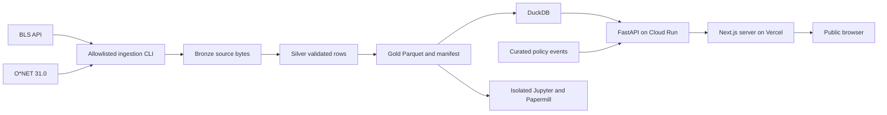

# Architecture

The pilot stores Bronze and Silver on local disk. A manifest published last makes a release discoverable and records three layer checksums, the normalization version and the UTC retrieval time. Identical artifacts cannot be replaced with different content. The API queries Gold directly and checks its hash before serving each version in a process. It has zero write endpoints and does not make outbound calls for each request.

Next.js owns presentation and same-origin CSV delivery. FastAPI owns data selection and export semantics. Analysis packages run in a separate locked Python environment. OpenAPI types flow from FastAPI to the web workspace at build time.

Cloud Run and Vercel configs support a read-only pilot. The deployment image carries an immutable copy of the pilot snapshots. The target production architecture keeps persistent authoritative snapshots in versioned S3-compatible storage, transactional metadata and reviews in PostgreSQL, and bounded work in separate Cloud Run Jobs. These integrations remain planned. [Runtime ADR](docs/adr/0001-runtime.md)

## Socrates execution boundaries

- **Vercel web application.** Routed Next.js workspaces and a TypeScript API gateway. The public workbench executes bounded descriptive, deterministic, and policy-coverage operations against pinned releases and returns JSON run records.
- **Application backend.** FastAPI owns data contracts and read endpoints. The target private control plane uses PostgreSQL and authorization for user-owned job state. Those control-plane integrations remain outstanding.
- **Research compute.** The allowlisted Python study router uses scikit-learn for Ridge, NumPy for statistical operations and Monte Carlo, and native DuckDB for Parquet reads. Notebook execution runs outside the Vercel web request. Custom C, C++, or Rust modules require a measured bottleneck and a verified interface.
- **Data lakehouse.** Bronze, Silver and Gold versions use checksums and local Parquet. Production object storage remains unconnected.
- **Research workbench.** JupyterLab and Papermill execute the parameterized model notebook. Its run fingerprint includes the pinned release, input parameters, numerical library versions and results. No hosted notebook job endpoint is exposed.
